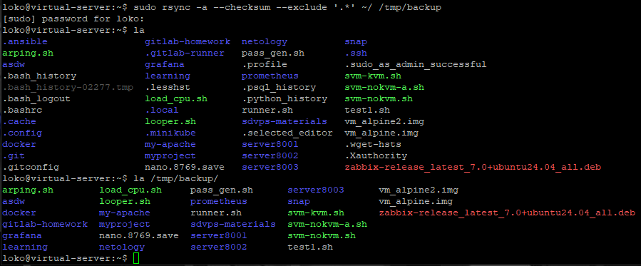
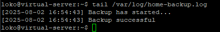
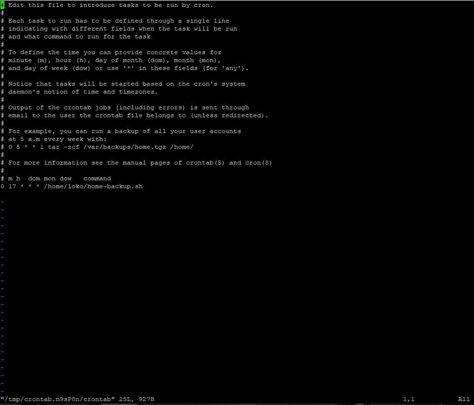

# [Задание](https://github.com/netology-code/sflt-homeworks/blob/main/3.md) к занятию "`Резервное копирование`"


---

### Задание 1

```

sudo rsync -a --checksum --exclude '.*' ~/ /tmp/backup

```



---

### Задание 2

Скрипт [home-backup.sh](home-backup.sh)





---

